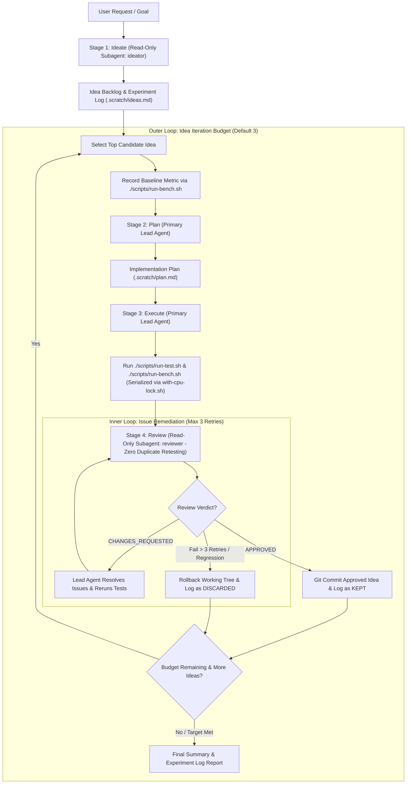

# Ideate-Plan-Execute-Review Workflow

An autonomous, multi-agent continuous improvement lifecycle designed for performance optimization, refactoring, and iterative feature development.

Maintains a persistent **Experiment Log** (`.scratch/ideas.md`, gitignored) tracking both **Kept** (accepted and committed) and **Discarded** (reverted with failure reasons and lessons learned) hypotheses across iterations.

---

## 1. Subagent Specifications

Role prompt templates are maintained under:
- [`ideator.md`](../../subagents/ideator.md)
- [`reviewer.md`](../../subagents/reviewer.md)

| Role | Tool Capabilities | Primary Function |
| :--- | :--- | :--- |
| **`ideator`** | Read-only exploration (no source edits) | Deep exploration of `INNER_DIR`, bottleneck discovery, hypothesis generation, and maintaining `.scratch/ideas.md`. |
| **Lead Agent** | Full write & commands | Baseline measurement (`./scripts/run-bench.sh`), plan authoring (`.scratch/plan.md`), code execution, test runs (`./scripts/run-test.sh` + `./scripts/check-boundary.sh`), delta benchmarking, git commits, and issuing authoritative Test Execution Receipts. |
| **`reviewer`** | Read + git diff inspection (source editing forbidden) | Independent git diff audit across outer and inner repos, `AGENTS.md` compliance, test receipt verification, and baseline-to-delta validation under the **Zero-Duplicate-Work Policy**. |

---

## 2. Workflow Lifecycle

### Stage 1: Ideation (`ideator` subagent)
1. Inspect any existing `.scratch/ideas.md` so previously **Discarded Ideas** are never repeated.
2. Spawn a read-only subagent using the prompt template in [`ideator.md`](../../subagents/ideator.md) to explore `INNER_DIR` (`crates/*`, `web/`) and formulate concrete hypotheses with exact `./scripts/run-bench.sh` baseline/delta commands and `./scripts/run-test.sh` regression commands.

### Stage 2: Planning & Baseline Measurement (Primary Lead Agent)
1. Select the top `Backlog` candidate from `.scratch/ideas.md` and mark it `In-Progress`.
2. Capture the quantitative baseline before touching code using `./scripts/run-bench.sh -s <suite> -f <filter>`.
3. Author the plan in `.scratch/plan.md`.

### Stage 3: Execution & Post-Change Delta Verification (Primary Lead Agent)
1. Apply tightly scoped changes adhering to `AGENTS.md`.
2. Run `./scripts/check-boundary.sh` and `./scripts/run-test.sh -c` (or `-p <crate>`).
3. Run `./scripts/run-bench.sh -s <suite> -f <filter>` to capture the post-change delta.
4. Assemble the authoritative **Test Execution Receipt** (commands, exit code `0`, test counts, baseline vs. delta table).

### Stage 4: Independent Review & Outer-Loop Commit / Rollback
1. Spawn a fresh read-only subagent using the prompt template in [`reviewer.md`](../../subagents/reviewer.md) with the diff, plan path, and Test Execution Receipt (reviewer trusts the receipt and does NOT re-run tests or benchmarks).
2. If `APPROVED`:
   - Commit inner submodule changes (if any) and sync via `./scripts/run-pr.sh --commit-gitlink`, then commit outer changes using `GIT_AUTHOR_NAME <GIT_AUTHOR_EMAIL>` from `scripts/harness.env`.
   - Record the commit SHA and baseline-vs-delta gain under **Kept Ideas** in `.scratch/ideas.md`.
3. If `CHANGES_REQUESTED` (> 3 retries) or negative performance delta:
   - Roll back uncommitted changes in both inner submodule and outer workspace.
   - Record the failure rationale and lessons learned under **Discarded Ideas** in `.scratch/ideas.md`.
