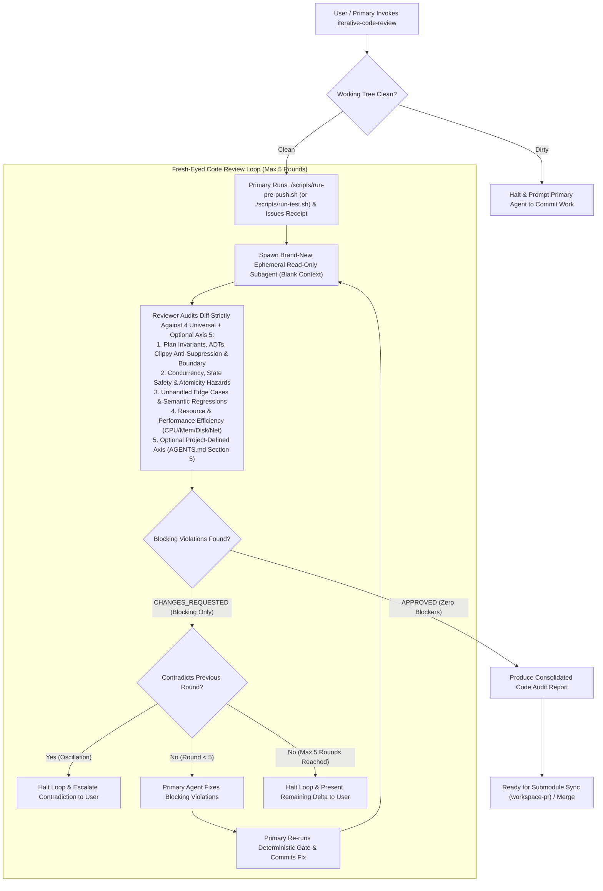

# Iterative Code Review Lifecycle

An autonomous, high-signal code review protocol that audits changes across the outer harness and inner code submodule against an approved plan's invariants and engineering standards. Every review iteration spawns a **brand-new ephemeral subagent instance** with a blank conversational context.

To eliminate LLM compiler/linter roleplay, style nitpicking, and redundant test execution, this skill enforces **The Deterministic Wall Rule** and **4+1 Axis Primacy**.



---

## 1. Governing Rules

### Rule 1: The Deterministic Wall Rule
* The Primary Agent runs `./scripts/run-pre-push.sh` (or `./scripts/run-test.sh` + `./scripts/check-boundary.sh`) **before** invoking the Code Reviewer and provides the **Deterministic Gate Receipt**.
* The Code Reviewer treats the deterministic pass as an **established axiom**.
* Any check caught deterministically by `rustc`, `clippy`, `rustfmt`, `tsc`, `biome`, `vitest`, or `./scripts/check-boundary.sh` is **STRICTLY OFF-LIMITS** to the Code Reviewer—**EXCEPT** for auditing the semantic validity of `#[expect(clippy::...)]` / `#[allow(clippy::...)]` lint relaxations on new or touched functions/types (which `clippy` accepts syntactically regardless of whether the `reason` is valid).
* The reviewer is **prohibited** from nitpicking syntax, formatting, naming conventions, import ordering, or re-running test suites.

### Rule 2: 4 Universal Axes + Optional Project-Defined Axis 5
1. **Axis 1 — Plan Invariant Faithfulness, Domain ADTs, Strict Clippy Anti-Suppression, Boundary & Docs Sync**:
   - **Plan Invariants**: Does the code uphold every relational integrity rule, ordering guarantee, surface parity contract, and `INV-BOUNDARY-*` rule from the Approved Plan and `AGENTS.md`?
   - **Roadmap & Invariant Registry Sync (`docs/internal/`)**: When `Target Roadmap Items` are specified (and not `"N/A"` or `"deferred to parent merge"`), verify `docs/internal/roadmap/{roadmap.md,completed-milestones.md}` and `docs/internal/invariants.md` accurately reflect graduated items or newly introduced `INV-*` invariants.
   - **Domain Modeling & Anti-Primitive Obsession**: Expect expressive ADTs (`enum`s, tagged unions, cohesive parameter/domain `struct`s) that make illegal states unrepresentable. Flag **Primitive Obsession** and **Boolean Blindness**.
   - **Zero Unjustified Clippy Relaxations (Boy Scout Rule on New & Touched Functions/Types)**:
     - Any newly added or modified production function/type **MUST** eliminate relaxed structural, complexity, and inlining Clippy lints (`clippy::too_many_lines`, `clippy::too_many_arguments`, `clippy::cognitive_complexity`, `clippy::type_complexity`, `clippy::large_enum_variant`, `clippy::struct_excessive_bools`, `clippy::fn_params_excessive_bools`, `clippy::inline_always`) by refactoring into cohesive parameter `struct`s, ADTs, or focused helper functions.
     - **Verified Hot-Path Performance Exception**: Suppressing via `#[expect(clippy::..., reason = "...")]` is permitted **only** on verified hot paths where `reason` documents a proven runtime/hardware performance gain. Cold-path or hand-wavy excuses (`"cohesive handler"`, `"exhaustive dispatcher"`) are **Blocking Violations**.
     - Numeric/pointer `cast_*` suppressions must state exact domain bounds proofs, and production `unwrap_used` / `expect_used` are banned (allowed in `#[cfg(test)]`, `tests/`, and `benches/`).
2. **Axis 2 — Concurrency, State Safety & Atomicity Hazards**: TOCTOU races, non-atomic file/state updates, locks held across `.await`, deadlocks, atomic ordering flaws, or unsafe `mmap`/resource lifecycle issues.
3. **Axis 3 — Unhandled Edge Cases & Semantic Regressions**: Silent behavioral drift, partial-write/error-path state leaks, boundary corruption (empty inputs, `0`, `NaN`/`Inf`, integer overflow), or wire/API contract regressions not covered by tests.
4. **Axis 4 — Resource & Performance Efficiency (CPU, Memory, Disk, Network)**:
   - Unintended $O(N^2)$ loops, redundant multi-pass scans, blocking compute on async worker threads, unbounded buffers, unnecessary full-buffer clones or per-item heap allocation churn, leaked temp files, or unbounded network/API payloads.
   - *Guardrail*: Speculative cold-path nano-optimizations on startup/CLI argument parsing are banned.
5. **Axis 5 (Optional, Project-Defined) — Domain Invariants (`AGENTS.md` Section 5)**:
   - Read `AGENTS.md` Section 5 and `docs/internal/invariants.md` (`INV-DOMAIN-*`). If domain rules are configured, audit the diff strictly against them; otherwise mark Axis 5 `N/A (Not Configured)`.

### Rule 3: Blocking-Only Output & 5-Round Hard Cap
* **Zero P2/P3 Noise**: Every finding must be a **Blocking Violation** of Axes 1–4 (or configured Axis 5).
* **Immediate Approval**: If zero blocking violations exist, immediately return `APPROVED`.
* **Max 5 Rounds**: Capped at **5 rounds maximum**.

---

## 2. Step-by-Step Execution Protocol

### Step 1: Pre-Flight Cleanliness & Deterministic Gate Receipt
1. Verify clean working trees in both `INNER_DIR` and outer repository (`git status --short`). Commit changes using the configured `GIT_AUTHOR_NAME <GIT_AUTHOR_EMAIL>` from `scripts/harness.env`.
2. Run `./scripts/run-pre-push.sh` (or `./scripts/run-test.sh` + `./scripts/check-boundary.sh`) and capture the **Deterministic Gate Receipt**.

### Step 2: Launch Fresh Read-Only Code Reviewer Subagent
Spawn a **brand-new, blank-context read-only subagent** using your runtime's subagent tool:
* **Antigravity**: `invoke_subagent` (`TypeName: "research"`, `Model: "inherit"`, `Workspace: "inherit"`)
* **OpenCode**: `task` (`subagent_type: "explore"` or read-only agent)
* **Claude Code**: `Agent` (`subagent_type: "Explore"` or read-only agent)

Pass the following prompt verbatim (filling in `<...>`):

```markdown
You are an independent Principal Systems Engineer conducting a high-signal semantic, concurrency, resource efficiency, and invariant code review.

### THE DETERMINISTIC WALL & OPERATIONAL RULES (MANDATORY)
1. DETERMINISTIC WALL AXIOM: The code has ALREADY passed the compiler, type checker, formatter, Clippy (-D warnings), check-boundary.sh, and deterministic test suites (see Deterministic Gate Receipt). You are STRICTLY FORBIDDEN from nitpicking syntax, formatting, naming conventions, import ordering, or style. However, because Clippy only validates `#[expect(clippy::..., reason = "...")]` syntactically, you MUST audit all Clippy lint suppressions on new or touched functions/types under Axis 1.
2. ZERO-DUPLICATE-WORK: DO NOT re-run compilers, linters, test suites, or benchmarks unless the Deterministic Gate Receipt is missing or shows a non-zero exit code.
3. BLOCKING VIOLATIONS ONLY (NO P2/P3 NITS): Report ONLY Blocking Violations across the audit axes below. If zero blocking violations exist, issue APPROVED.
4. READ-ONLY: Use read tools to inspect callers, shared state, locks, AGENTS.md Section 5, and docs/internal/invariants.md inside the target worktree. Do NOT edit any files.
5. RESPECT NON-GOALS: Never demand changes that violate declared Non-Goals.

### AUDIT AXES
1. Axis 1 — Plan Invariants, Domain ADTs, Strict Clippy Anti-Suppression, Boundary (INV-BOUNDARY-*) & Docs Sync
2. Axis 2 — Concurrency, State Safety & Atomicity Hazards
3. Axis 3 — Unhandled Edge Cases & Semantic Regressions
4. Axis 4 — Resource & Performance Efficiency (CPU, Memory, Disk, Network)
5. Axis 5 (Optional, Project-Defined) — Enforce AGENTS.md Section 5 & docs/internal/invariants.md (`INV-DOMAIN-*`) if configured; otherwise mark `N/A (Not Configured)`.

### INPUT DATA
Target Worktree: <Worktree Path>
Approved Plan Invariants & Non-Goals: <Approved Plan Invariants & Non-Goals>
Target Roadmap Items: <["RM-..."] | "N/A" | "deferred to parent merge">
Deterministic Gate Receipt: <Deterministic Gate Receipt>
Outer & Inner Submodule Commits & Diff: <git log & git diff>

### OUTPUT REPORT FORMAT
## 1. Audit Verdict: [APPROVED | CHANGES_REQUESTED]
## 2. Audit Matrix
| Audit Axis | Status [Pass | Blocking Violation | N/A] | Assessment |
| :--- | :--- | :--- |
| Axis 1: Plan Invariants, ADTs, Clippy Anti-Suppression & Boundary | [Pass / Blocking Violation] | [Concise assessment] |
| Axis 2: Concurrency, State Safety & Atomicity | [Pass / Blocking Violation] | [Concise assessment] |
| Axis 3: Edge Cases & Semantic Regressions | [Pass / Blocking Violation] | [Concise assessment] |
| Axis 4: Resource & Performance Efficiency (CPU/Mem/Disk/Net) | [Pass / Blocking Violation] | [Concise assessment] |
| Axis 5: Project-Defined Domain Invariants | [Pass / Blocking Violation / N/A] | [Concise assessment] |
## 3. Blocking Violations (Omit if APPROVED)
- [Axis 1 / 2 / 3 / 4 / 5] `[file:line]`: Exact description of the broken invariant, ADT flaw, unjustified Clippy suppression, concurrency/state hazard, semantic regression, resource bottleneck, or domain defect.
## 4. Actionable Remediation Guidance (Omit if APPROVED)
- Exact fix required for each blocking violation.
```
