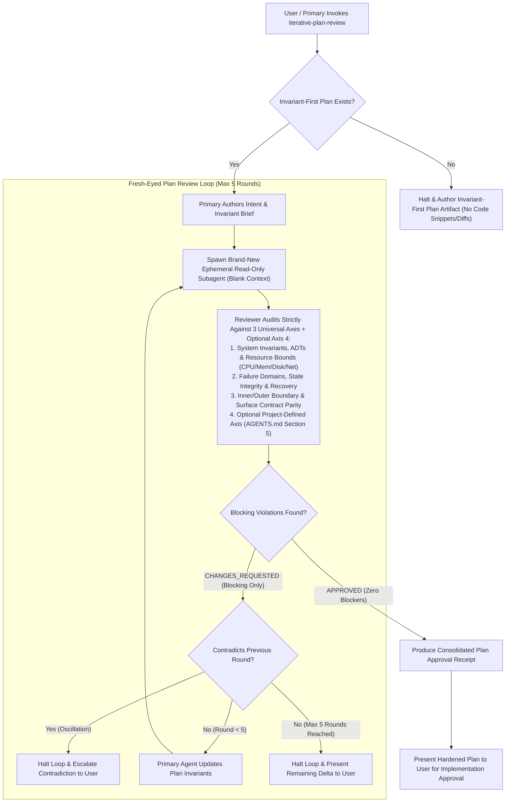

# Iterative Plan Review Lifecycle

An autonomous technical design review protocol that hardens **Implementation Plans** before any code is written. Every review iteration spawns a **brand-new ephemeral subagent instance** with a blank conversational context, ensuring fresh-eyed isolation without confirmation bias or anchoring.

To eliminate pre-code compiler/linter roleplay, repetitive debate, and token waste, this skill enforces **The Deterministic Wall Rule** and **Invariant & Boundary Primacy**.



---

## 1. Governing Rules

### Rule 1: The Deterministic Wall Rule
* Any check caught downstream by `cargo check`, `cargo clippy` (`pedantic`/`perf`/`unsafe_code = "deny"`), `rustfmt`, `tsc`, `biome`, `vitest`, or `./scripts/check-boundary.sh` is **STRICTLY FORBIDDEN** during Plan Review.
* The reviewer **MUST NOT** act as an informal pre-compiler or nitpick syntax, style, import ordering, local type definitions, CLI test flags, or file line numbers.

### Rule 2: Invariant & Boundary Primacy (3 Universal Axes + Optional Axis 4)
1. **Axis 1 — System Invariants, Domain ADTs & Resource Bounds (CPU, Memory, Disk, Network)**:
   - **State, Relational Integrity & Cohesive Domain ADTs**: Ordering guarantees, state transitions, niche types (`NonZero*`, etc.), and cohesive domain parameter/context `struct`s and `enum` state machines. Flag plans specifying bloated multi-argument interfaces, multi-boolean configuration flags, nested tuple return types, or monolithic god-components that would force downstream `too_many_arguments`, `excessive_bools`, `type_complexity`, or `too_many_lines` suppressions.
   - **Resource Bounds**: Unintended $O(N^2)$ loops, unbounded memory buffers, blocking async worker threads, non-atomic file writes, or unbounded network/RPC payloads.
2. **Axis 2 — Failure Domains, State Integrity & Recovery**:
   - Behavior under corrupted/truncated inputs, invalid IDs/bounds, partial writes, cancellations, concurrent races, and atomic rollback strategies.
3. **Axis 3 — Inner/Outer Boundary & Surface Contract Parity**:
   - **Clean-Room Boundary (`INV-BOUNDARY-1` & `INV-BOUNDARY-2`)**: Zero project code in the outer harness, and zero agentic/host leaks (`AGENTS.md`, `CLAUDE.md`, `.agents/`, `.claude/`, `.opencode/`, `harness.env`, `docs/internal/`, `/home/...`) inside `INNER_DIR`.
   - **Contract Parity**: Ensuring changes across CLI / API / TypeScript frontend remain coherent and respect the task's `backwards_compatible` flag without unintended breaking changes to persisted schemas or public APIs.
4. **Axis 4 (Optional, Project-Defined) — Domain Invariants (`AGENTS.md` Section 5)**:
   - Check `AGENTS.md` Section 5 ("Project-Defined Review Axis") and `docs/internal/invariants.md` (`INV-DOMAIN-*`). If project-defined domain rules are declared, enforce them strictly as Axis 4; if none are declared, mark Axis 4 `N/A (Not Configured)`.

### Rule 3: Ban on Pseudo-Code, Line-by-Line Designs & Mechanical Call-Site Enumeration
* **No Code Snippets in Plans**: Implementation Plan artifacts are structured strictly as **Invariant-First Architecture Specifications** (see [`docs/internal/plans/README.md`](../../docs/internal/plans/README.md)).
* **No Naming or Signature Bikeshedding**: Deliberations over variable names, helper function names, or line-by-line pseudo-code are explicitly prohibited.
* **Mode-Aware Semantic-vs-Mechanical Call-Site Boundary**:
  - **Compiler-Enforced Retirements (`0` Legacy References)**: When a plan deletes, renames, or alters the type/signature of an existing symbol, static type checking guarantees call-site totality. Reviewers are **strictly forbidden** from flagging omitted mechanical call-sites of that symbol (unless parallel execution lanes require disjoint file-ownership partitioning).
  - **Coexisting APIs & Ambient Patterns (Quantified Invariants)**: When legacy overloads remain live (`backwards_compatible: true`), across untyped or polyglot boundaries (CLI, HTTP/JSON, RPC), or for ambient behavioral patterns, plans express internal totality via **universally quantified invariants** (*"All writes to X route through helper Y; zero direct callers remain"*) alongside explicit module and public-surface scope. Reviewers **may** flag omitted public surfaces or genuine subsystem split-brain, **but are strictly forbidden** from requesting enumeration of private helper names inside an already-scoped module.

### Rule 4: Blocking-Only Output & 5-Round Hard Cap
* **Zero P2/P3 Noise**: Every reported finding must be a **Blocking Violation** of Axis 1, Axis 2, Axis 3, or configured Axis 4.
* **Immediate Approval**: If zero blocking violations exist, the reviewer **MUST** immediately return `APPROVED`.
* **Max 5 Rounds**: Capped at **5 rounds maximum**.

---

## 2. Step-by-Step Execution Protocol

### Step 1: Pre-Flight Plan & Reference Census Check
1. Verify the target **Implementation Plan** artifact exists in `.scratch/plan-<lane>.md` (gitignored, or the active session plan path).
2. Before launching Round 1, run an exhaustive codebase search (`rg`) for every retired, signature-changed, or semantically migrated symbol, constant, or ambient pattern. Populate module and public-surface scope from that search.
3. Ensure the plan follows the **Invariant-First** structure without pseudo-code or raw diffs.

### Step 2: Launch Fresh Read-Only Plan Reviewer Subagent
Spawn a **brand-new, blank-context read-only subagent** using your runtime's subagent tool:
* **Antigravity**: `invoke_subagent` (`TypeName: "research"`, `Model: "inherit"`, `Workspace: "inherit"`)
* **OpenCode**: `task` (`subagent_type: "explore"` or read-only agent)
* **Claude Code**: `Agent` (`subagent_type: "Explore"` or read-only agent)

Pass the following prompt verbatim (filling in `<...>`):

```markdown
You are an independent Principal Systems Architect conducting an Invariant & Boundary audit of a proposed Implementation Plan.

### THE DETERMINISTIC WALL & SCOPE RULES (MANDATORY)
1. DETERMINISTIC WALL: You are STRICTLY FORBIDDEN from commenting on anything caught by compilers, type checkers, linters (Clippy/Biome/tsc), formatters, or test runners. Do NOT verify line numbers, function signatures, type mismatches, or syntax.
2. NO PSEUDO-CODE, NAMING DELIBERATIONS, OR MECHANICAL CALL-SITE ENUMERATION: Do NOT request code snippets, pseudo-code, variable/function renames, or line-by-line function designs. Respect the Mode-Aware Call-Site Boundary: (a) when a plan retires/alters a typed symbol, do NOT flag omitted mechanical call-sites caught by the compiler; (b) for coexisting APIs (`backwards_compatible: true`), untyped boundaries, or ambient patterns governed by a quantified invariant, you MAY flag omitted public surfaces or subsystem split-brain, but NEVER request private intra-module helper lists.
3. BLOCKING VIOLATIONS ONLY (NO P2/P3 NITS): Report ONLY Blocking Violations across the audit axes below. If zero blocking violations exist, immediately issue APPROVED.
4. READ-ONLY BOUNDARY CHECK: Use read tools solely to verify existing contracts, schemas, AGENTS.md Section 5, and docs/internal/invariants.md inside the target worktree. Do NOT edit files.
5. RESPECT NON-GOALS: Never demand changes that violate declared Non-Goals.

### AUDIT AXES
1. Axis 1 — System Invariants, Domain ADTs & Resource Bounds (CPU/Mem/Disk/Net)
2. Axis 2 — Failure Domains, State Integrity & Recovery
3. Axis 3 — Inner/Outer Boundary (INV-BOUNDARY-1/2) & Surface Contract Parity
4. Axis 4 (Optional, Project-Defined) — Check AGENTS.md Section 5 and docs/internal/invariants.md (`INV-DOMAIN-*`). Enforce if configured; otherwise mark `N/A (Not Configured)`.

### INPUT DATA
Target Worktree: <Worktree Path>
Backwards Compatible: <true | false>
Intent & Context Brief: <Intent Brief>
Implementation Plan Path: <Path to plan markdown file>

### OUTPUT REPORT FORMAT
## 1. Audit Verdict: [APPROVED | CHANGES_REQUESTED]
## 2. Invariant Audit Matrix
| Audit Axis | Status [Pass | Blocking Violation | N/A] | Assessment |
| :--- | :--- | :--- |
| Axis 1: System Invariants, ADTs & Resource Bounds | [Pass / Blocking Violation] | [Concise assessment] |
| Axis 2: Failure Domains, State Integrity & Recovery | [Pass / Blocking Violation] | [Concise assessment] |
| Axis 3: Inner/Outer Boundary & Surface Parity | [Pass / Blocking Violation] | [Concise assessment] |
| Axis 4: Project-Defined Domain Invariants | [Pass / Blocking Violation / N/A] | [Concise assessment] |
## 3. Blocking Violations (Omit if APPROVED)
- [Axis 1 / 2 / 3 / 4]: Exact invariant gap, resource trap, failure hazard, or contract break.
## 4. Required Plan Remediation (Omit if APPROVED)
- Concise invariant or boundary specification required to resolve each blocker.
```
